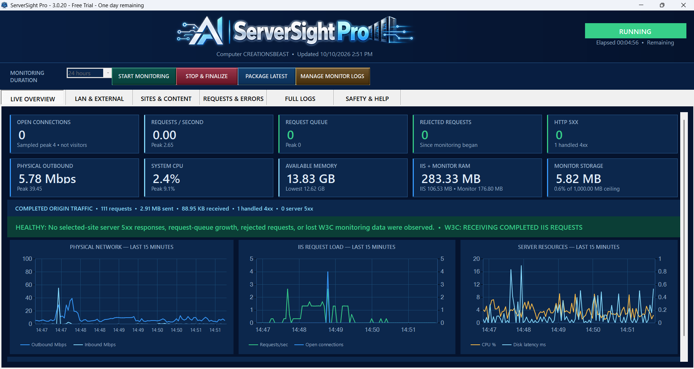
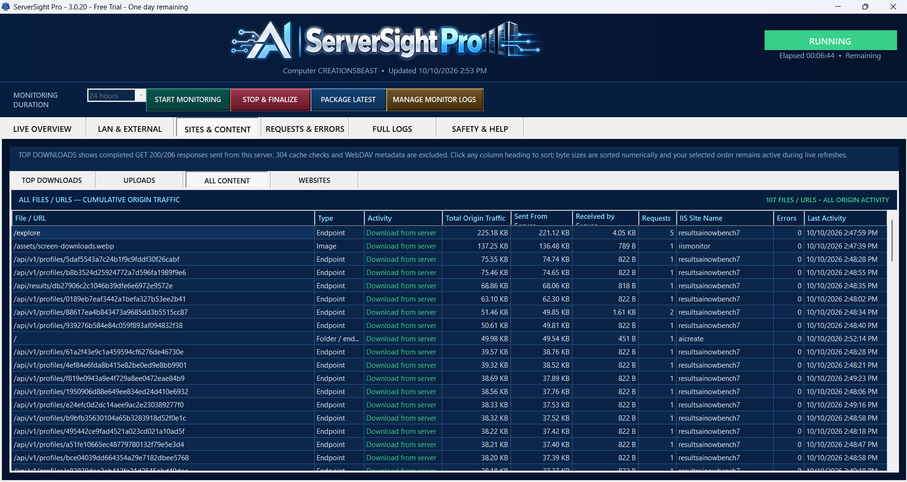

  

<h1 align="center">ServerSight Pro</h1>

<strong>Your server. In full view.</strong> Live IIS monitoring, Windows resource insights and local session reports.

  <a href="https://download.aicreatenow.com/software/ServerSightPro3.0.0.20microsoft2.exe"><strong>Download free trial</strong></a> ·
  <a href="https://serversightpro.com/">Official website</a> ·
  <a href="https://serversightpro.com/screenshots.html">Screenshots &amp; video</a> ·
  <a href="https://buy.stripe.com/5kQdRb77Z28UfME5ZQ5kk03">Buy lifetime license</a>

Version 3.0.20 · Windows x64 · Two-day free trial · $39.99 lifetime license for one computer

  

## Understand the activity behind your websites

ServerSight Pro brings website requests, bandwidth, HTTP errors and Windows resource measurements into one desktop workspace. Choose the IIS sites you want to watch, record a session and keep reports you can review later.

For home labs, independent developers, small businesses and server administrators, it offers a practical way to see what is happening at your Windows IIS origin. Monitoring reads existing information without changing your websites, application pools, bindings, logging fields, DNS or firewall rules.

## One workspace, six useful views

| View | What you can see |
| --- | --- |
| **Live Overview** | Requests, connections, queues, network throughput, CPU, available memory, IIS worker resources and disk activity, with recent time-series charts. |
| **LAN & External** | Separate views of local-network and public TCP/UDP activity, alongside whole-adapter measurements. |
| **Sites & Content** | Selected websites, completed downloads, uploads and URLs, with request counts and transferred bytes. |
| **Requests & Errors** | Completed request history, 4xx/5xx filtering, readable HTTP status explanations and suggested actions. |
| **Full Logs** | Local CSV, TXT and JSON reports, with ZIP packaging for a finalized session. |
| **Safety & Help** | Measurement guidance, license activation and controls for product-owned results. |

Core telemetry updates every three seconds. Detailed live tables publish up to once a minute when changed, and at finalization.

  

## From a question to a saved report

1. **Choose your sites.** Select the IIS websites you want included.
2. **Set your recording window.** Choose 1, 6, 12, 24, 48, 72 or 168 hours and start monitoring.
3. **Explore the activity.** Move between server, network, content and request views.
4. **Keep the evidence.** Use **Stop & Finalize** to save the session, then create a ZIP when you want to share it.

Results are saved locally, normally in the application's results folder on your Desktop. They are not automatically uploaded. Reports can contain server and client details; review them before sharing. Recording remains subject to available storage, system availability and license duration.

## Try it on your server

**The two-day free trial starts only when you choose “Start Two-Day Free Trial” in the application.** Installing alone does not start the clock. The trial lasts 48 elapsed hours, including time while the app is closed.

A **$39.99 one-time purchase** provides a lifetime license for one activated computer, with no recurring license subscription. Enter your delivered 10-digit key before starting the trial, during the trial from **Safety & Help**, or after it expires. Initial activation requires Internet access. Payment alone does not activate the application.

[Download for Windows x64](https://download.aicreatenow.com/software/ServerSightPro3.0.0.20microsoft2.exe) · [Buy a lifetime license](https://buy.stripe.com/5kQdRb77Z28UfME5ZQ5kk03) · [Purchase & refund policy](https://aicreatenow.com/cancellation.html#software-refunds)

## Before you install

- **64-bit Windows with IIS**, the required monitoring components and existing IIS W3C logs.
- **.NET Framework 4.8 or newer.**
- **Administrator access** for setup and monitoring.
- **Internet access for initial license activation.**

Setup checks prerequisites; it does not install IIS or enable missing logging fields. The installer creates Desktop and Start Menu shortcuts and a Windows Apps uninstall entry. Ordinary uninstall preserves saved Desktop results and separate trial and registration records.

### Understand what the numbers mean

Connection counts are not unique visitors. Requests served entirely by a CDN cache never reach IIS and are outside the origin view. Whole-adapter traffic includes other applications and protocols, so it will differ from selected-site request totals. Available details depend on existing log fields and Windows counters; individual request detail may be sampled at high load.

[Explore all features](https://serversightpro.com/features.html) · [Read setup and measurement guidance](https://serversightpro.com/help.html)

## Support and publisher

**AI Creations Now Software Development**  
[info@aicreatenow.com](mailto:info@aicreatenow.com) · 1-866-315-4750  
[Application privacy](https://serversightpro.com/privacy.html) · [Company website](https://aicreatenow.com/)

[Getting started & common questions](GETTING-STARTED.md) · [Support](SUPPORT.md) · [GitHub release history](https://github.com/aicreatenowdom/iis-monitor/releases)

## About this repository

This repository provides documentation and artwork for proprietary software. Application source code is not included. GitHub's **Code → Download ZIP** downloads the documentation and artwork; use the [official Windows download](https://serversightpro.com/download.html) to get the application and its applicable terms.

The existing repository address is retained so published links continue to work. For current branding, downloads and documentation, use **[ServerSightPro.com](https://serversightpro.com/)**.

© 2026 AI Creations Now Software Development.
